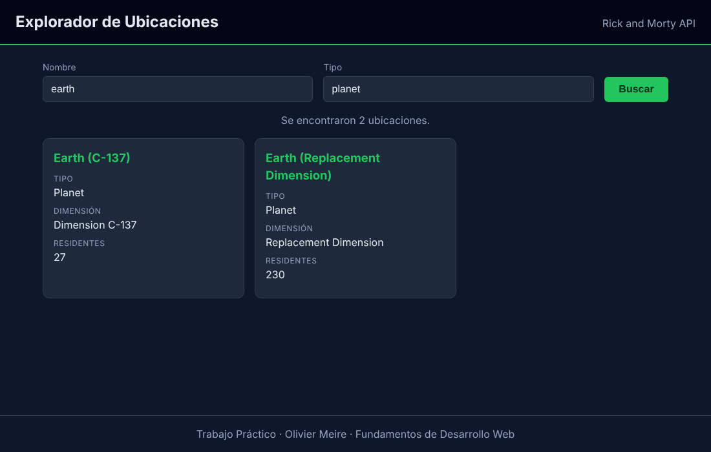

# Explorador de Ubicaciones · Rick and Morty

Página web de una sola pantalla que permite buscar ubicaciones de la serie Rick and Morty por nombre y por tipo, consultando la API pública [The Rick and Morty API](https://rickandmortyapi.com) y mostrando los resultados en tarjetas.

**Autor:** Olivier Meire · Fundamentos de Desarrollo Web · UCSA
**Variante:** B · Ubicaciones (último dígito de cédula: 4, 5 o 6)
**Endpoint:** `https://rickandmortyapi.com/api/location`

## Captura


## Funcionalidades
- Búsqueda por nombre y filtro por tipo (por ejemplo, `Planet`), combinados en una sola petición.
- Tarjetas con nombre, tipo, dimensión y cantidad de residentes. Los valores vacíos o `unknown` se muestran como «Desconocido».
- Estados: «Buscando…» con el botón desactivado, mensaje de «sin resultados» (404) y mensaje de error de conexión.
- Guarda la última búsqueda en `localStorage` y la repite al recargar la página.

## Tecnologías
HTML5 semántico, CSS3 (Grid, Flexbox, variables), JavaScript ES6+, Fetch API con async/await y localStorage.

## Estructura
```
tp-meire-olivier/
├── index.html
├── README.md
├── css/estilos.css
├── js/app.js
└── img/captura.png
```
